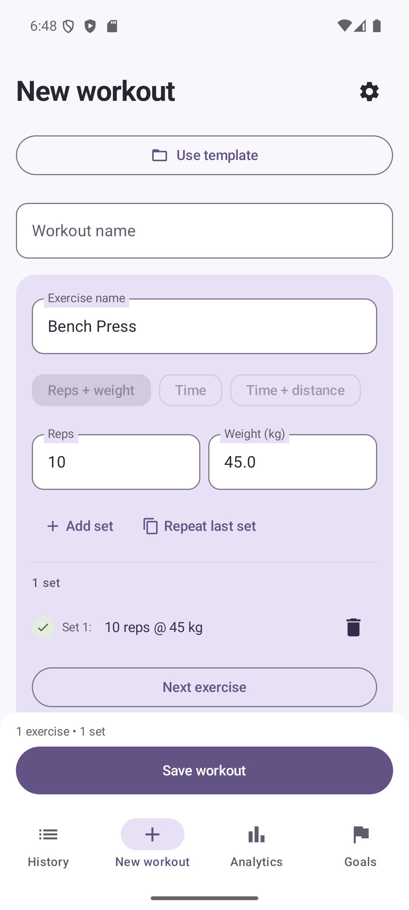
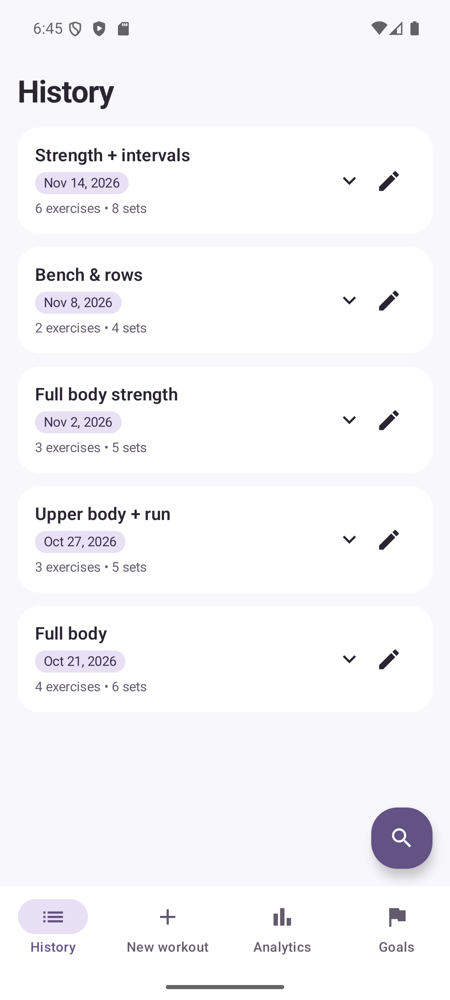
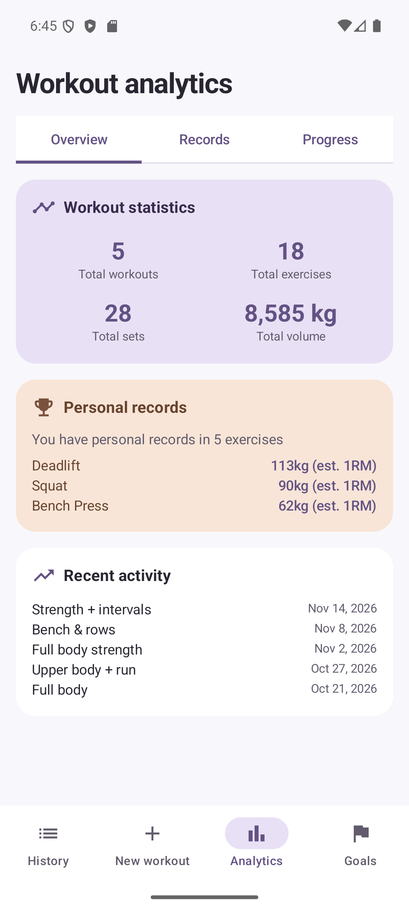
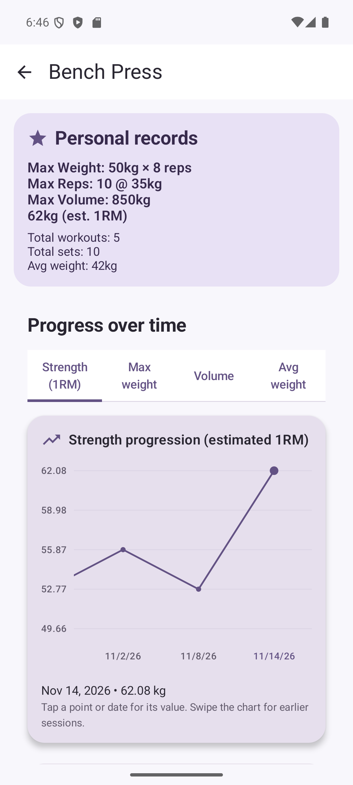
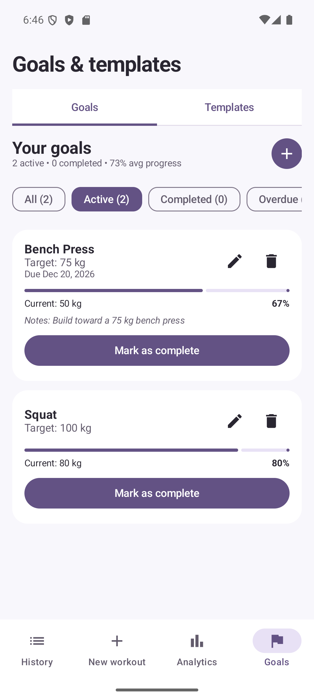
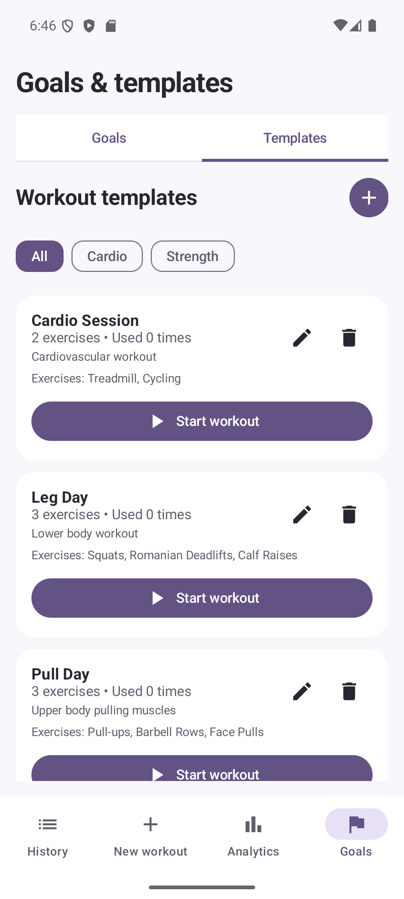
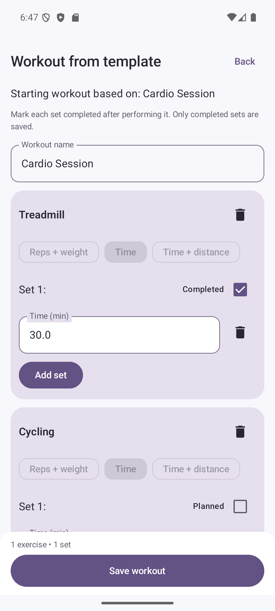
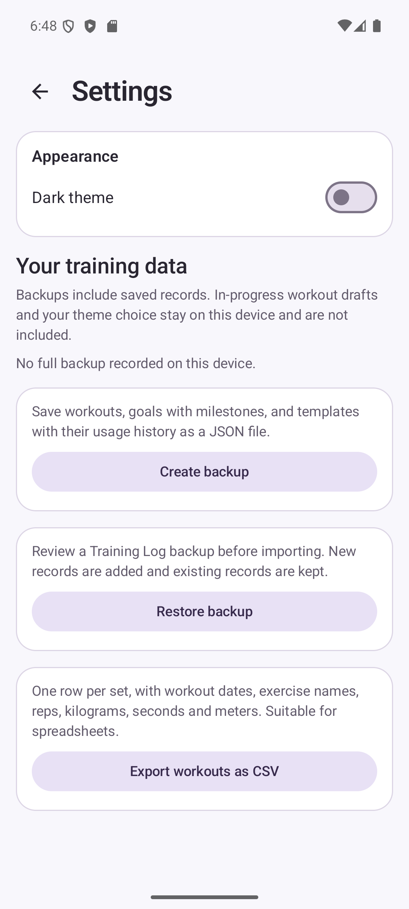
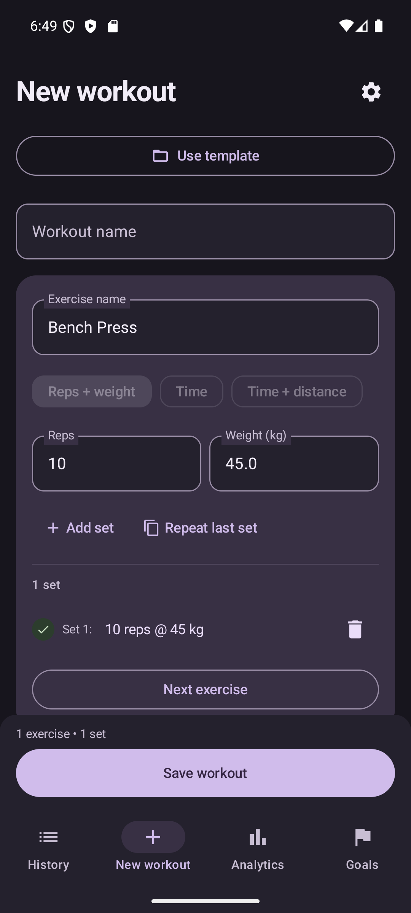
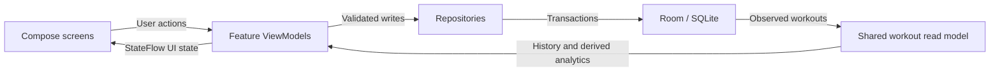

# Training Log App

**An Android workout journal for logging sets during training and seeing how performance changes across sessions.**

A personal project by [Eeri Hyppänen](https://github.com/eerihyppanen), built with Kotlin, Jetpack Compose, Material 3, and Room.

The full application source is private and available to recruiters and hiring managers on request.

AI assistance: OpenAI Codex was used to assist with development, including code implementation, refactoring, and testing. The project was developed and reviewed under my direction.

## App gallery

| Log a workout | Review a session | Explore your progress |
| :---: | :---: | :---: |
|  |  |  |

| Exercise progress | Goals | Templates |
| :---: | :---: | :---: |
|  |  |  |

| Template workout | Backup and export | Dark mode |
| :---: | :---: | :---: |
|  |  |  |

*Screenshots taken on a Pixel 7 emulator running Android 16 with sample training data.*

## Project overview

Logging a set happens in the middle of a workout. Reviewing weeks of progress happens later. I built Training Log around both tasks. During training, the editor keeps the current exercise, its sets, and the save action within reach. Later, History and Analytics let you revisit a session or follow one exercise across multiple workouts.

## Features

### Workout logging and history

- **Three ways to record a set.** Log repetitions and weight, duration, or duration with distance. Exercise names autocomplete from previous workouts.
- **Less typing between sets.** **Repeat last set** adds a copy of the last logged set while preserving anything already typed in the fields. **Use values** fills the fields from the previous session for the same exercise and measurement type.
- **An editor that keeps your place.** Each exercise groups the inputs and logged sets. Completed exercises collapse, individual sets can be edited, and a fixed save bar shows the current counts. Validation appears beside the relevant input.
- **Recover and correct entries.** An unfinished regular or template workout can be resumed after relaunch. Saved workouts can be edited in place, including their date, exercises, and sets. History cards expand for details, and exercise search opens the corresponding progress page.

### Analytics and goals

- **Training overview.** See workout, exercise, and set counts, total strength volume, personal records, and recent activity.
- **Strength progress.** Exercise details show records for weight, reps, and volume, plus estimated one-rep max (1RM) where eligible. Switch between charts for estimated 1RM, maximum weight, volume, and average weight. Select a session to see its date and value.
- **Timed progress.** Duration and distance have separate charts for timed exercises. The app shows distance when it was recorded and keeps timed sets out of strength records.
- **Goals.** Track weight, reps, volume, consistency, frequency, or endurance. Goals can have deadlines, notes, and milestones. Progress updates from saved workouts, and filters help find active, completed, or overdue goals.

### Templates, backups, and appearance

- **Reusable routines.** Build a template from scratch or copy a saved workout. Starting a template opens a draft with planned sets. Check off the sets you perform to add them to the saved workout.
- **Local backup and export.** Settings supports JSON backups of saved workouts, goals with milestones, and templates. Restore previews the import and merges missing records. CSV export produces one row per workout set for spreadsheet analysis.
- **Light and dark themes.** Material 3 components share a lavender and sage palette, and the app remembers the selected theme. Bottom navigation keeps History, New workout, Analytics, and Goals within reach.

## What changed in the 2.0 milestone

The 2.0 milestone focused on reliable everyday logging. It introduced durable workout drafts, saved-workout editing, inline validation, and completion tracking for template sets. It also added JSON backup and restore, CSV export, and distinct charts for timed training. Underneath, feature-specific ViewModels and a shared read model replaced the original central ViewModel, and Room migrations preserved existing training records.

## Architecture

The app is written in **Kotlin** with **Jetpack Compose**, **Material 3**, and **Navigation Compose**. It runs on Android 10 (API 29) and later. The production app lives in one Gradle module organized by feature. A separate benchmark module runs performance measurements and exercises the optimized build.

### State ownership and how a save reaches the screen

- **Compose screens render state and report actions.** Workout entry, history, analytics, goals, templates, and settings have their own state owners. Each route collects its ViewModel's state with lifecycle awareness.
- **Repositories handle persistence.** A workout save validates the draft, writes the workout with its exercises and sets in a Room transaction, and then appears in the database observation flow. History and Analytics update from that change, and Goals can recalculate from the same saved history.
- **The shared read model does the common work once.** It derives one analytics snapshot per distinct saved workout history on a background dispatcher. History, exercise search, goal progress, and workout suggestions share the observed data. Previous-set suggestions are also cached during measurement edits to avoid rescanning unchanged history.
- **Dependencies are wired at application startup.** An application-scoped container supplies Room, repositories, preferences, the shared read model, and ViewModel factories. Constructor injection lets tests substitute dependencies at those boundaries.

### Data model and recovery

| Area | Design decision |
| --- | --- |
| Workout structure | A workout has ordered exercises, and each exercise has ordered sets. A stable exercise ID links the same exercise across workouts, templates, goals, and analytics. |
| Measurements | A set has a defined measurement type. Strength uses repetitions and kilograms. Timed sets store seconds and, where recorded, meters. The UI presents minutes and kilometers. |
| Schema migrations | Room schema version 5 has tested migration paths from versions 1 through 4. Migrations preserve saved records, backfill exercise identities, and store exercise and set positions explicitly. |
| Draft recovery | Regular and template drafts store raw text and row IDs in Room. Saved instance state carries the active draft IDs. This lets an unfinished session recover incomplete values and protects it after a failed save. Editing a saved workout uses a separate draft keyed by its workout ID. |
| Template completion | Completion is stored in the template workout draft. Saving converts only checked rows into workout sets, so planned values never appear as performed sets in History or Analytics. |
| Backup merge | A versioned JSON format represents the saved records independently of the database file. The preview is read-only. Confirming a restore checks for matching IDs again inside one transaction, imports missing records, and preserves existing local records. |

## Testing and performance

- **216 local tests passed** for the 2.0 milestone. Coverage includes SQLite migrations, record ordering, failed saves and draft recovery, backup validation and rollback, analytics calculations, navigation, and form interactions.
- **Debug and release builds passed.** An optimized Pixel 7 emulator run exercised History, exercise charts, Analytics, Goals, and saving a template workout after checking a set.
- **Performance tooling** uses an isolated benchmark app, a 120-workout sample history, and baseline profiles to compare cold startup and History scrolling. Emulator timing identified a scrolling follow-up. Real-phone timing and the Templates layout in landscape with enlarged text remain areas to check.
